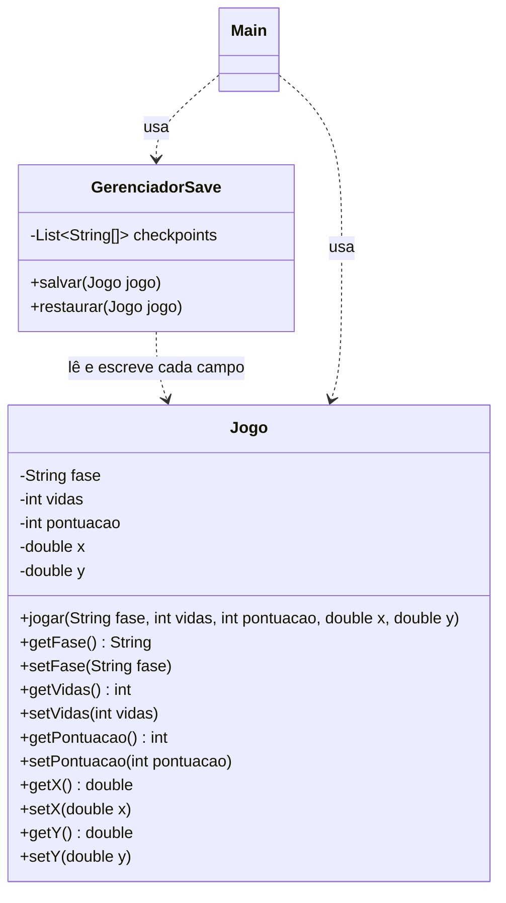
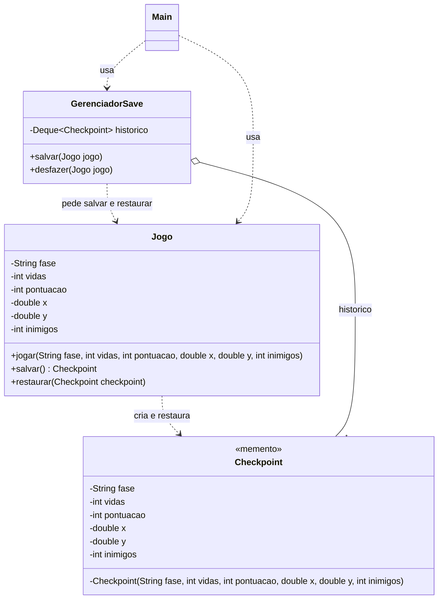

# Respostas: Padrão Memento

## Exercício 1: Aplicações

**1. Jogo com checkpoints de progresso**

Faz sentido usar Memento. O jogo precisa guardar o estado em um momento e voltar para ele depois, que é exatamente o que o padrão faz. Com o Memento o próprio jogo cria o checkpoint e o sistema de save só guarda, sem conhecer os atributos internos do jogo.

**2. Editor de texto com desfazer/refazer**

Faz sentido usar Memento. Cada alteração pode gerar um retrato do documento, e o histórico guarda esses retratos em uma pilha. Para desfazer é só restaurar o último, sem que o histórico precise saber como o documento é feito por dentro.

**3. Formulário em várias etapas (wizard)**

Faz sentido usar Memento. A cada passo dá para salvar um memento com os dados preenchidos, e quando o usuário volta o formulário é restaurado exatamente como estava. Os dados continuam encapsulados no formulário, quem controla os passos só guarda os mementos.

**4. Classe `Configuracao` lida uma vez por um único consumidor fixo**

Não faz sentido usar Memento. Não existe histórico e ninguém precisa voltar para um estado anterior, a configuração é só lida uma vez. Criar memento e caretaker aqui seria overengineering.

**5. Classe `Ponto` com apenas `x` e `y`**

Não faz sentido usar Memento. A classe só guarda duas coordenadas e nunca precisa restaurar um estado passado. Se um dia precisasse, copiar `x` e `y` já resolveria, então o padrão só deixaria complicado algo que é simples.

---

## Exercício 2: Rastreando o anti-pattern em um projeto real

O código original ficou no pacote `antes` e a versão refatorada no pacote `depois`, para dar para comparar os dois.

### 1. Por que getters e setters para tudo quebram o encapsulamento?

O encapsulamento serve para o objeto controlar o próprio estado. Quando o `Jogo` tem getter e setter para todos os atributos, qualquer classe pode ler e mudar a fase, as vidas, a pontuação e a posição diretamente, então na prática os campos são públicos. O `Jogo` deixa de ser dono do seu estado.

O risco para a consistência é que ninguém garante que o estado faz sentido. Alguém de fora pode colocar vidas negativas, trocar a fase sem mexer na posição ou restaurar só uma parte dos campos e esquecer o resto. O `GerenciadorSave` mesmo seta os campos um por um, e se ele esquecer algum o jogo fica com um estado misturado, metade do checkpoint e metade do jogo atual.

### 2. Quantos pontos mudam se o `Jogo` ganhar um atributo `inimigos`?

Além do atributo e do parâmetro no `jogar`, seria preciso alterar:

- no `Jogo`, criar o `getInimigos` e o `setInimigos`;
- no `GerenciadorSave.salvar`, colocar `String.valueOf(jogo.getInimigos())` no vetor, na posição certa;
- no `GerenciadorSave.restaurar`, ler `c[5]`, converter com `Integer.parseInt` e chamar o `setInimigos`.

Ou seja, são pelo menos quatro pontos em duas classes diferentes. Isso mostra que o `GerenciadorSave` está fortemente acoplado ao `Jogo`: ele conhece cada campo, o tipo e a ordem de todos. Qualquer mudança no `Jogo` obriga a mexer no gerenciador, mesmo que a função dele (guardar e devolver checkpoints) não tenha mudado.

### 3. Consequências de o snapshot virar uma lista de `String[]`

Como tudo vira `String`, o compilador não ajuda em nada. As principais consequências são:

- **Ordem:** o significado de cada posição só existe na cabeça de quem escreveu. Se alguém trocar `c[1]` com `c[2]`, o código compila e o jogo volta com as vidas no lugar da pontuação sem dar nenhum erro.
- **Conversões:** todo valor precisa ser convertido para texto ao salvar e convertido de volta ao restaurar (`parseInt`, `parseDouble`). Se a conversão falhar o erro só aparece em tempo de execução.
- **Erros silenciosos:** um checkpoint antigo com menos campos pode dar `ArrayIndexOutOfBoundsException` ou, pior, carregar valores errados sem avisar.
- **Legibilidade:** olhando para um `String[]` não dá para saber que aquilo é um checkpoint do jogo, nem o que cada posição significa.

### 4. Refatoração com Memento

#### Diagrama de classes: antes

#### Diagrama de classes: depois

#### Código refatorado

Fica em `src/main/java/br/venson/net/designpatterns/memento/depois/`:

- [Jogo.java](src/main/java/br/venson/net/designpatterns/memento/depois/Jogo.java): originator, cria o checkpoint com `salvar()` e volta para ele com `restaurar(...)`. O memento `Checkpoint` fica dentro dele, como classe interna.
- [GerenciadorSave.java](src/main/java/br/venson/net/designpatterns/memento/depois/GerenciadorSave.java): caretaker, guarda os checkpoints em uma pilha sem olhar o conteúdo.
- [Main.java](src/main/java/br/venson/net/designpatterns/memento/depois/Main.java): cliente, joga, salva dois checkpoints e desfaz até o histórico ficar vazio.

#### Justificativa das decisões de design

**Memento `Checkpoint` imutável.** O `Checkpoint` guarda uma cópia de todos os atributos do jogo em campos `private final` e a classe é `final`. Assim, depois de criado, o retrato não pode ser alterado por ninguém, e um checkpoint salvo sempre volta exatamente como estava no momento do save.

**`Checkpoint` como classe interna do `Jogo`.** Coloquei o `Checkpoint` dentro do `Jogo` e deixei o construtor e os campos `private`. Em Java a classe de fora consegue acessar os membros privados da classe interna, então só o `Jogo` consegue criar um checkpoint e ler o que tem dentro dele. Se ele ficasse em um arquivo separado com getters de pacote, como no exemplo da aula, o `GerenciadorSave` e o `Main` também conseguiriam ler os campos, porque estão no mesmo pacote.

**Interface estreita e interface ampla.** Para o `GerenciadorSave` e o `Main` o `Checkpoint` não tem nenhum método público, eles só conseguem guardar e passar o objeto adiante. Essa é a interface estreita. O `Jogo` enxerga todos os campos para montar e restaurar o estado, que é a interface ampla. Assim o estado não vaza, mesmo saindo do `Jogo` para ser guardado.

**Originator `Jogo` com `salvar()` e `restaurar(...)`.** Tirei todos os getters e setters do `Jogo`. Agora quem decide o que entra no retrato e como restaurar é o próprio jogo, então o estado restaurado sempre fica completo e consistente, sem risco de alguém esquecer um campo. Deixei só o `toString` para o `Main` conseguir mostrar o estado no console.

**Caretaker `GerenciadorSave`.** O gerenciador só pede o checkpoint para o jogo e guarda em uma `Deque<Jogo.Checkpoint>`, usada como pilha. No `desfazer` ele tira o último e entrega de volta para o jogo restaurar. Ele não sabe quais campos existem e nem precisa saber. Mantive a mensagem "Nenhum checkpoint salvo." quando a pilha está vazia, como no original.

**Atributo `inimigos`.** Adicionei o atributo `inimigos` só no `Jogo` e no `Checkpoint` para mostrar na prática que um campo novo não mexe no caretaker.

### 5. Como fica adicionar um atributo novo? E o histórico?

Depois da refatoração, um atributo novo muda só o `Jogo` e o `Checkpoint`, que ficam no mesmo arquivo: coloca o campo nos dois, passa ele no `salvar()` e lê no `restaurar(...)`. O `GerenciadorSave` não é alterado, porque ele só trabalha com o objeto `Checkpoint` inteiro e não com os campos. Foi o que aconteceu com o `inimigos`.

O histórico agora é uma `Deque<Jogo.Checkpoint>` e não uma lista de `String[]`. Cada campo do checkpoint tem o seu tipo de verdade (`int`, `double`, `String`), então não existe mais conversão de texto nem dependência da ordem das posições. Se alguém tentar colocar no histórico algo que não é um checkpoint, ou ler um campo de fora do `Jogo`, o erro aparece na compilação e não escondido na hora de rodar.
